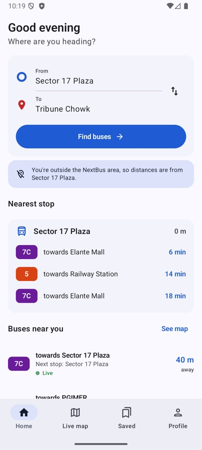
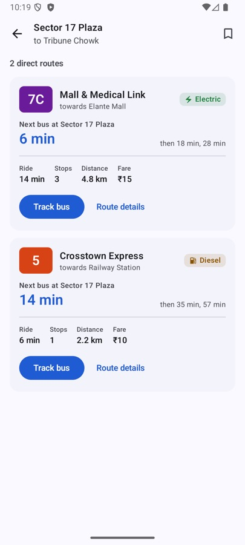
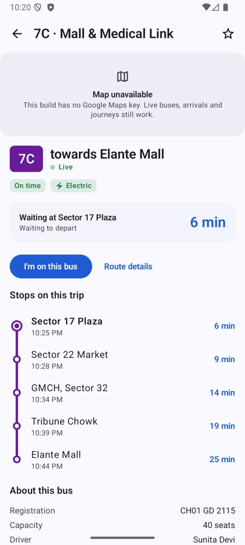
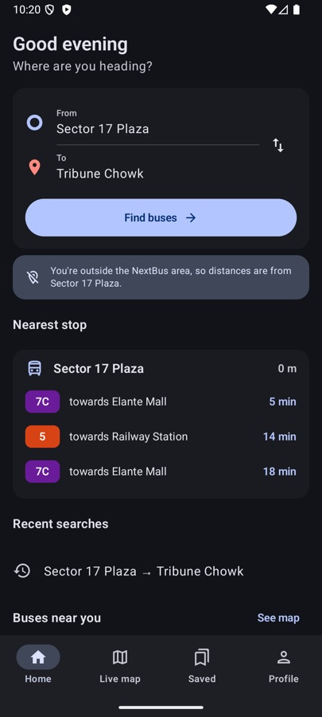
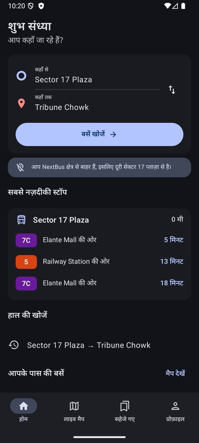

# NextBus

A live bus companion for Android: find direct buses between two stops, watch them move in real time, track your trip, and reach help fast. Built with Kotlin, Jetpack Compose and Material 3.

NextBus runs **entirely on the device**. A seeded transit network (stops, routes, timetables, fleet) lives in Room, and a deterministic simulator moves every bus along its route in real time. Live tracking, arrival times, "nearby" sorting and freshness indicators all work out of the box, with no account and no backend.

| Home | Journey results | Bus tracking | Dark mode | हिन्दी |
|---|---|---|---|---|
|  |  |  |  |  |

## Features

- **Journey planner:** pick start and destination stops (search by name or route number), swap them, and see every direct route with the next live buses, ride time, number of stops, distance and fare.
- **Live tracking:** follow a bus on the map (auto-follow pauses when you pan), see whether it's on time or late, its speed, and a stop-by-stop timeline with ETAs and clock times.
- **Freshness you can trust:** every bus shows *Live*, *Updated 3 min ago* or *Offline*. One demo bus deliberately drops off the feed so these states can be seen.
- **Nearby:** the nearest stop with its next arrivals, and the closest buses. Without location permission, or outside the service area, distances fall back to the city centre and the app says so.
- **Routes and stops:** timetable departures, a direction toggle and live buses for each route; live arrivals at any stop.
- **Live map:** all buses with heading arrows, filtered by route; tap a bus for a summary. Without a Maps key the screen falls back to a live list.
- **Trips:** tap *I'm on this bus* to record a trip. History shows where you boarded and got off, the duration and the distance.
- **Saved:** favourite routes, saved journeys, recent searches and trip history.
- **SOS:** one tap to dial 112, share your live trip (route, bus, next stop, driver contact and a map link), or text or call your emergency contacts. The driver's number appears only in that shared message.
- **Profile and settings:** local name, travel stats, validated emergency contacts, light/dark/system theme, Material You colour, and **English / हिन्दी** switching without a restart.
- Every screen handles **loading, empty, error and success** states, with an edge-to-edge layout, TalkBack labels and 48 dp touch targets.

## How it works

```
Compose screen ──observes──▶ ViewModel (StateFlow<UiState>)
                                 │ combines
                                 ▼
             Use cases: journey search, nearby, arrivals, trips, fares
                                 │
                                 ▼
Repository interfaces
  TransitRepository       Room, seeded from SeedNetwork (versioned)
  LiveBusRepository       BusSimulator, ticking every second   ◀── swap for a real feed
  ScheduleRepository      timetable derived from the same model
  UserDataRepository      Room: favourites, journeys, recents, trips
  PreferencesRepository   DataStore: theme, name, onboarding, emergency contacts
  LocationRepository      fused location, permission-aware
  ConnectivityRepository  network state (only map tiles need it)
```

- **Unidirectional data flow:** each ViewModel exposes one `StateFlow` of a sealed UI state. One-off events, such as snackbars, go through a channel.
- **The simulator** is pure Kotlin and driven by the clock: for a given network and time it always returns the same snapshot, so it needs no stored state and is fully unit-tested. Each route's fleet size and terminus layover are derived so the advertised headway is exact, which keeps the timetable and the live positions consistent. Buses drift between 0 and 3 minutes late.
- **Pluggable backend:** `LiveBusRepository` is shaped like a GTFS-realtime feed (vehicle positions plus per-stop predictions). Bind a different implementation in `core/data/di/DataModule.kt` and the UI does not change.

## Demo data

The network covers **Chandigarh**: 21 stops at real landmarks (coordinates are approximate) and 5 routes. Routes, timetables, buses and driver details are **fictional sample data**, and driver phone numbers use a non-dialable `000` exchange. To change the data, edit `core/data/seed/SeedNetwork.kt` and increase `VERSION`. Installed apps re-seed on their next launch without touching user data.

## Tech stack

| Area | Choice |
|---|---|
| Language | Kotlin 2.4 (AGP 9 built-in Kotlin) |
| UI | Jetpack Compose, Material 3, Navigation Compose with type-safe routes |
| Architecture | MVVM, unidirectional data flow, Coroutines and Flow |
| DI | Hilt (KSP) |
| Local data | Room, DataStore |
| Maps and location | Google Maps SDK with Maps Compose, Fused Location Provider |
| Testing | JUnit 4, kotlinx-coroutines-test, Turbine |
| Build | Gradle 9.8, version catalog, R8 for release |

`compileSdk` and `targetSdk` are 36, and `minSdk` is 24. AndroidX releases that require compileSdk 37 are held back; see the note at the top of `gradle/libs.versions.toml`.

## Getting started

### Requirements

- Android Studio with Android SDK Platform 36
- JDK 17 or newer to run Gradle (Android Studio's bundled JDK works)

### Google Maps key (optional)

Everything except map tiles works without a key. To enable the map, add a Maps SDK for Android key to the git-ignored `local.properties` in the project root:

```properties
MAPS_API_KEY=your-key-here
```

In Google Cloud Console, restrict the key to the package names `com.ncs.nextbus` and `com.ncs.nextbus.debug` and to your signing certificate. Never commit keys.

### Build, test and lint

```bash
./gradlew assembleDebug testDebugUnitTest lintDebug
```

Debug builds install as `com.ncs.nextbus.debug`, so they can sit alongside a release install.

## Project structure

```
app/src/main/java/com/ncs/nextbus/
├── core/
│   ├── common/        geo math, time source, dispatcher qualifiers
│   ├── model/         domain models: stops, routes, live buses, trips, preferences
│   ├── data/          Room, DataStore, seed network, simulator, repositories, Hilt modules
│   ├── domain/        use cases: journey search, nearby, arrivals, trips, fares, phone validation
│   ├── designsystem/  theme (colour, type, spacing) and shared components
│   └── ui/            formatting, permissions, intents, language helpers
├── feature/           home, search, bus, route, stop, map, saved, profile, sos, onboarding
├── navigation/        type-safe routes and the nav host
└── MainActivity.kt    single activity: splash, theme, edge-to-edge
```

Unit tests live in `app/src/test`. They cover geo math, seed data integrity, simulator behaviour across a full day, journey search, arrivals, location fallback, trips, contact validation, stop search and the main ViewModels.

## License

MIT
